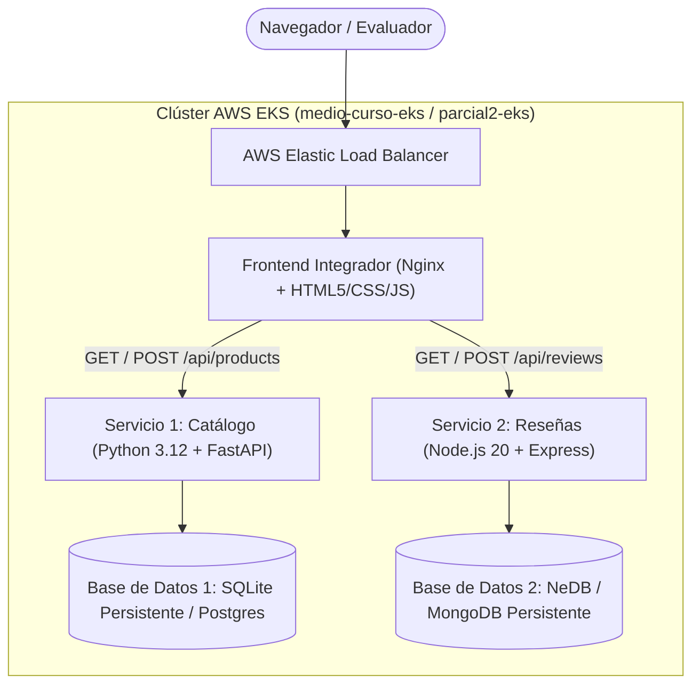

# Plan Maestro de Fases: Parcial 2 (Harness, SDD, K8s en AWS EKS)

> **Metodología Oficial:**
>
> - **Ingeniería:** Harness Engineering + Spec-Driven Development (SDD).
> - **Despliegue Cloud:** El mismo estándar enterprise utilizado para el servicio de Depósitos USD: **AWS EKS + AWS ECR + GitHub Actions (CI/CD con OIDC Keyless) + Manifiestos K8s con LoadBalancer**.

---

## 1. Arquitectura del Sistema Multi-Lenguaje

---

## 📅 2. Desglose de Fases de Implementación

### 🔹 Fase 1: Arnés de Ingeniería (Harness) y Especificaciones SDD

* **Objetivo:** Definir el marco formal de trabajo guiado por especificaciones antes de codificar.
* **Entregables:**
  1. `agents/`: Roles de agentes del arnés (`leader.md`, `spec_author.md`, `implementer.md`, `reviewer.md`, `deployer.md`).
  2. `specs/01-product-service/spec.md`: Especificación del microservicio en Python (contrato OpenAPI, modelos, endpoints, reglas y pruebas).
  3. `specs/02-review-service/spec.md`: Especificación del microservicio en Node.js (contrato REST, esquemas de reseñas, pruebas).
  4. `specs/03-frontend/spec.md`: Especificación de la interfaz unificada y llamadas asíncronas a ambas APIs.
  5. `specs/04-k8s-aws-deployment/spec.md`: Especificación de la infraestructura en AWS (EKS, ECR, LoadBalancer, Service Discovery).
  6. Matriz de estados: `pending -> spec_ready -> approved -> in_progress -> review -> done`.

---

### 🔹 Fase 2: Implementación de los 2 Microservicios Independientes (Database-per-Service)

* **Objetivo:** Construir los dos backends desacoplados con sus bases de datos y pruebas unitarias.
* **Entregables:**
  1. **`services/product-service/` (Python 3.12 + FastAPI):**
     - Base de datos relacional independiente.
     - Endpoints: `GET /health/live`, `GET /health/ready`, `GET /api/products`, `POST /api/products`.
     - Suite de pruebas unitarias con `pytest`.
     - `Dockerfile` optimizado multi-stage con usuario no-root.
  2. **`services/review-service/` (Node.js 20 + Express):**
     - Almacén de datos independiente basado en documentos.
     - Endpoints: `GET /health/live`, `GET /health/ready`, `GET /api/reviews`, `POST /api/reviews`.
     - Suite de pruebas unitarias automatizadas con `jest`.
     - `Dockerfile` optimizado multi-stage con usuario no-root.

---

### 🔹 Fase 3: Frontend Integrador

* **Objetivo:** Crear una interfaz web atractiva y responsiva que consuma ambos servicios al mismo tiempo.
* **Entregables:**
  1. **`frontend/`:**
     - Aplicación web con interfaz moderna (tarjetas de productos, estrellas de calificación, formularios en tiempo real).
     - Servidor de producción ultraligero con `nginx:alpine`.
     - Reverse Proxy interno en Nginx para enrutar `/api/products` hacia el servicio Python y `/api/reviews` hacia el servicio Node.js (evitando problemas de CORS).
     - `Dockerfile` de producción.

---

### 🔹 Fase 4: Orquestación Local y Manifiestos de Kubernetes

* **Objetivo:** Garantizar que todo funcione con un solo comando tanto en local como en la nube.
* **Entregables:**
  1. `docker-compose.yml`: Para pruebas locales inmediatas de los 3 contenedores y sus bases de datos en una red compartida.
  2. Manifiestos de Kubernetes en `k8s/`:
     - `01-namespace.yaml`: Espacio de nombres aislado `parcial2`.
     - `02-product-service.yaml`: Deployment y Service (ClusterIP) con sondas de salud.
     - `03-review-service.yaml`: Deployment y Service (ClusterIP) con sondas de salud.
     - `04-frontend.yaml`: Deployment y Service (LoadBalancer) para crear el balanceador público en AWS.
     - `kustomization.yaml`: Orquestador declarativo.

---

### 🔹 Fase 5: Pipeline Automatizado de CI/CD (GitHub Actions + AWS OIDC)

* **Objetivo:** Reproducir el flujo automatizado del proyecto anterior:
* **Entregables:**
  1. `.github/workflows/ci-cd.yml`:
     - **Job 1 (Test):** Ejecuta `pytest` en Python y `npm test` en Node.js.
     - **Job 2 (Build & Push):** Autenticación con AWS IAM OIDC (sin credenciales fijas), compila las imágenes Docker y las sube a AWS ECR (`product-service`, `review-service`, `frontend`).
     - **Job 3 (Deploy):** Aplica los manifiestos al clúster EKS.

---

### 🔹 Fase 6: Despliegue en AWS EKS, Grabación del Video y Desmontaje Seguro ($0 Costo)

* **Objetivo:** Poner todo en vivo en AWS, registrar la evidencia para el docente y apagarlo de inmediato.
* **Pasos:**
  1. Crear el clúster con `eksctl create cluster`.
  2. Desplegar los recursos y obtener la URL pública del LoadBalancer.
  3. Ejecutar la lista de verificación del video (mostrar `kubectl get nodes`, `kubectl get pods`, crear productos y reseñas en vivo con F12 abierto).
  4. Ejecutar inmediatamente `eksctl delete cluster` para garantizar **$0.00 de gastos innecesarios**.
