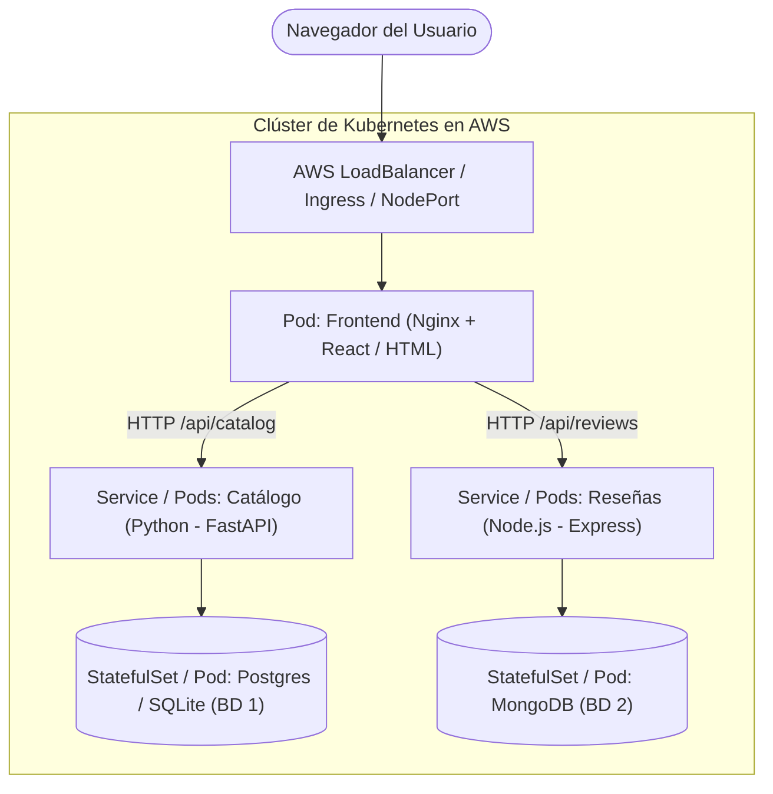

# Guía de Implementación: Parcial 2 (Microservicios, K8s en AWS y Arnés)

> **Contexto de la solicitud del docente:**
> *"Como ya tienen el  harnés. Hacer 2 servicios independientes uno en un lenguaje otro en otro lenguaje cada uno con su BD. Y un front que consulte a ambos servicios y lo desplieguen con k8s en aws. Cada uno propone su solución y lo sube en git y pone video del despliegue."*

---


## 2. Requerimientos del Parcial 2 Desglosados

| Requerimiento                             | Descripción                                                                                      | Criterio de Éxito                                                               |
| :---------------------------------------- | :------------------------------------------------------------------------------------------------ | :------------------------------------------------------------------------------- |
| **1. Dos servicios independientes** | Un servicio en un lenguaje (ej. Python) y el otro en un lenguaje distinto (ej. Node.js o Go).     | Código desacoplado en carpetas separadas, cada uno con su propio framework web. |
| **2. Base de datos por servicio**   | Principio *Database per Service*. Cada servicio tiene y administra su propio almacén de datos. | El Servicio 1 no accede directamente a la BD del Servicio 2 ni viceversa.        |
| **3. Frontend unificado**           | Aplicación web que consume ambas APIs REST.                                                      | Pantalla interactiva que consulta y renderiza datos de ambos backends.           |
| **4. Kubernetes (K8s) en AWS**      | Contenedorizar todo con Docker y orquestarlo en K8s sobre AWS.                                    | Pods, Deployments y Services corriendo en AWS (EKS o EC2 con K8s/k3s).           |
| **5. Repositorio Git**              | Control de versiones con todo el código fuente y manifiestos `.yaml`.                          | Repositorio organizado y accesible.                                              |
| **6. Video del despliegue**         | Grabación en video demostrando el clúster activo y la aplicación funcionando.                  | Evidencia visual completa de la infraestructura y funcionalidad.                 |

---

## 3. Arquitectura de la Solución Propuesta



---

## 4. Propuesta de Dominio: "E-Commerce / Reseñas de Productos"

Para no perder tiempo con lógica de negocio compleja y enfocarse en la infraestructura:

### Servicio A: Catálogo de Productos (Python - FastAPI)

- **Lenguaje / Framework:** Python 3.12 + FastAPI.
- **Base de Datos:** PostgreSQL o SQLite.
- **Endpoints clave:**
  - `GET /api/products`: Devuelve la lista de productos (ID, nombre, precio, descripción).
  - `POST /api/products`: Permite agregar un producto nuevo.

### Servicio B: Reseñas y Comentarios (Node.js - Express)

- **Lenguaje / Framework:** Node.js (JavaScript/TypeScript) + Express.
- **Base de Datos:** MongoDB.
- **Endpoints clave:**
  - `GET /api/reviews`: Devuelve comentarios o valoraciones asociadas a los productos.
  - `POST /api/reviews`: Permite a un usuario dejar una calificación (1 a 5 estrellas) y comentario.

### Frontend: Panel Integrador

- **Tecnología:** React + Vite, o HTML5/CSS/JavaScript vanilla servido con una imagen Docker de `nginx:alpine`.
- **Funcionamiento:**
  - Llama a `GET /api/products` y lista los productos en tarjetas.
  - Al lado o debajo, llama a `GET /api/reviews` y muestra los comentarios de los clientes.
  - Tiene un formulario sencillo para agregar un producto o agregar un comentario.

---

## 5. Estructura de Carpetas Recomendada en Git

```text
proyecto-parcial-2/
├── .github/
│   └── workflows/          # Tu arnés de CI (pruebas y análisis de código)
│       └── ci.yml
├── services/
│   ├── product-service/    # Servicio 1 (Python)
│   │   ├── Dockerfile
│   │   ├── requirements.txt
│   │   ├── main.py
│   │   └── tests/
│   └── review-service/     # Servicio 2 (Node.js)
│       ├── Dockerfile
│       ├── package.json
│       ├── index.js
│       └── tests/
├── frontend/               # Frontend (React o HTML)
│   ├── Dockerfile
│   ├── nginx.conf
│   └── src/
├── k8s/                    # Manifiestos de Kubernetes
│   ├── 01-databases.yaml   # Deployments/Services para Postgres y Mongo
│   ├── 02-product-svc.yaml # Deployment y Service para Producto
│   ├── 03-review-svc.yaml  # Deployment y Service para Reseñas
│   ├── 04-frontend.yaml    # Deployment y Service (LoadBalancer) para el Front
│   └── ingress.yaml        # Opcional (si usas AWS Ingress Controller)
└── README.md               # Documentación y enlaces
```

---

## 6. Opciones de Despliegue en AWS

### Opción 1: AWS EKS (Elastic Kubernetes Service) — *Solución Enterprise*

- **Ventajas:** Es el servicio estándar de producción en la industria.
- **Cómo montarlo:** Usar `eksctl` (`eksctl create cluster --name parcial2 --region us-east-1 --node-type m7i-flex.large`).
- **Consideración:** Cuesta aproximadamente $0.10 USD/hora por el plano de control más el costo de las instancias EC2. **Recuerda apagarlo al terminar el video.**
- **Ventajas:** Entra dentro del Free Tier, es 100% K8s oficial y se monta en 5 minutos.
- **Cómo montarlo:**

  1. Levantar una instancia Ubuntu en AWS EC2 con puertos 80, 443 y 6443 abiertos en el Security Group.
  2. Instalar k3s: `curl -sfL https://get.k3s.io | sh -`.
  3. Ejecutar `kubectl apply -f k8s/`.
- Sigue siendo **Kubernetes en AWS**, cumple con la consigna al 100% y no genera sobrecostos inesperados.

---

## 7. Guion y Lista de Cotejo para el Video de Entrega

Para asegurar la calificación máxima, el video (de 5 a 10 minutos) debe estructurarse así:

1. **Introducción y Arquitectura (1 minuto):**
   - Presentación de los integrantes.
   - Mostrar el diagrama de arquitectura y explicar los dos lenguajes elegidos y sus respectivas bases de datos.
2. **Repositorio Git y Arnés (1-2 minutos):**
   - Mostrar la estructura del repositorio en GitHub.
   - Mostrar cómo corre el arnés de pruebas (las pruebas unitarias en GitHub Actions o localmente).
3. **Evidencia del clúster en AWS (2 minutos):**
   - Mostrar la consola de AWS (EKS o EC2).
   - Abrir terminal conectada y ejecutar:
     ```bash
     kubectl get nodes
     kubectl get pods -o wide
     kubectl get services
     ```
   - Explicar que cada pod (front, servicio Python, servicio Node, BDs) está en estado `Running`.
4. **Demostración funcional en el Navegador (2-3 minutos):**
   - Abrir la IP pública / DNS de AWS en el navegador.
   - Crear un producto nuevo y recargar para ver que persiste en la BD 1.
   - Crear una reseña nueva y mostrar que persiste en la BD 2.
   - Abrir las herramientas de desarrollador (`F12` -> pestaña *Network*) para que el docente vea las peticiones saliendo a las rutas de ambos microservicios.
