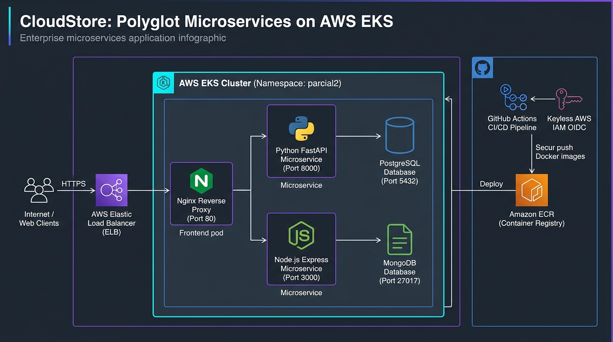

# CloudStore: Arquitectura Políglota de Microservicios en AWS EKS


Repositorio oficial para la entrega y sustentación del **Examen Parcial 2** del curso **Desarrollo de Aplicaciones para la Nube**.

---

## 🎥 Video Demostrativo y Sustentación

> 📺 **Enlace al video de demostración y sustentación en vivo:**  
> **[▶ Ver Grabación en Google Drive](https://drive.google.com/file/d/1RETgq93fj9SVKyPPD5ipQ_v0ncV_8vfu/view?usp=sharing)**
>
> **Contenido demostrado:**
> 1. Creación y verificación del clúster gestionado en **AWS EKS** v1.34 con `eksctl`.
> 2. Autenticación **Keyless IAM OIDC** en Amazon EKS y pipeline en **GitHub Actions**.
> 3. Despliegue de pods (`5/5 Running`) y obtención del DNS público de **AWS Elastic Load Balancer (ELB)**.
> 4. Aplicación SPA en vivo: comunicación anti-CORS mediante **Nginx Reverse Proxy** y llamadas concurrentes con `Promise.all()`.
> 5. Operaciones **CRUD en tiempo real** (creación y eliminación de productos en PostgreSQL y reseñas en MongoDB).
> 6. Documentación de contratos de API interactivos con **Swagger UI** (FastAPI y Express).
> 7. Pruebas de integración, verificación de repositorios **AWS ECR** y política de desmontaje seguro ($0.00 de costos ociosos).

---

## 📋 Resumen del Proyecto y Cumplimiento de Requerimientos

El proyecto implementa una solución de comercio electrónico ligera (**CloudStore**) bajo la metodología de **Harness Engineering** y **Spec-Driven Development (SDD)**, cumpliendo todos los requerimientos académicos:

| Requerimiento Académico                               | Implementación en este Repositorio                                                                                                                                                                                                      |   Estado   |
| :----------------------------------------------------- | :--------------------------------------------------------------------------------------------------------------------------------------------------------------------------------------------------------------------------------------- | :---------: |
| **1. Dos microservicios en lenguajes distintos** | **Microservicio 1:** Python 3.12 (FastAPI)**Microservicio 2:** Node.js 20 (Express)                                                                                                                                          | ✅ Cumplido |
| **2. Base de datos por microservicio**           | **PostgreSQL 16** (`products_db`) para productos.**MongoDB 7.0** (`reviews_db`) para reseñas.                                                                                                                           | ✅ Cumplido |
| **3. Frontend unificado anti-CORS**              | Interfaz web SPA moderna servida con **Nginx**, actuando como **Reverse Proxy** que consulta ambos backends en paralelo con `Promise.all()`.                                                                               | ✅ Cumplido |
| **4. Orquestación K8s en AWS**                  | Clúster gestionado en **Amazon EKS** (`parcial2-eks`) con manifiestos Kustomize en `k8s/` y exposición mediante **AWS Elastic Load Balancer (ELB)**.                                                                   | ✅ Cumplido |
| **5. CI/CD Automatizado**                        | Pipeline de **GitHub Actions** con autenticación **Keyless IAM OIDC** (sin access keys fijas), pruebas automáticas (`pytest` y `jest`), compilación multi-stage en **Amazon ECR** y despliegue a **EKS**. | ✅ Cumplido |
| **6. Documentación OpenAPI / Swagger**          | Swagger UI interactivo disponible para ambos microservicios (FastAPI y Express).                                                                                                                                                         | ✅ Cumplido |
| **7. Soporte CRUD Completo**                     | Operaciones de Creación (`POST`), Lectura (`GET`) y Eliminación (`DELETE`) en tiempo real desde la web.                                                                                                                          | ✅ Cumplido |

---

## 🏛️ Arquitectura del Sistema

<p align="center">
  
</p>

---

## 📦 Componentes del Sistema

### 1. Catálogo de Productos (`services/product-service`)

* **Lenguaje & Framework:** Python 3.12 + FastAPI + Pydantic v2.
* **Base de Datos:** PostgreSQL 16 gestionado con SQLAlchemy ORM.
* **Pruebas Automatizadas:** `pytest` con base de datos SQLite en memoria para tests aislados.
* **Seguridad del Contenedor:** Dockerfile multi-stage ejecutado bajo usuario no privilegiado (`UID 1000:appuser`).
* **Endpoints:**
  * `GET /health/live` / `GET /health/ready`: Sondas de salud de Kubernetes.
  * `GET /api/products`: Lista todos los productos disponibles.
  * `POST /api/products`: Crea un nuevo producto (nombre, descripción, precio, categoría, stock).
  * `DELETE /api/products/{id}`: Elimina un producto por su identificador.
  * `GET /docs`: Documentación interactiva Swagger UI nativa de FastAPI.

### 2. Reseñas y Calificaciones (`services/review-service`)

* **Lenguaje & Framework:** Node.js 20 + Express + Mongoose.
* **Base de Datos:** MongoDB 7.0 NoSQL para persistencia de documentos flexibles.
* **Pruebas Automatizadas:** `jest` + `supertest` con fallback a memoria volátil para pruebas sin dependencias de red.
* **Seguridad del Contenedor:** Dockerfile multi-stage con usuario sin privilegios `node`.
* **Endpoints:**
  * `GET /health/live` / `GET /health/ready`: Sondas de salud de Kubernetes.
  * `GET /api/reviews?productId={id}`: Consulta reseñas (globales o filtradas por producto).
  * `POST /api/reviews`: Publica una nueva reseña (autor, calificación 1 a 5 estrellas, comentario).
  * `DELETE /api/reviews/{id}`: Elimina una reseña por su ID.
  * `GET /api/reviews/docs`: Documentación interactiva Swagger UI con especificación OpenAPI 3.0.

### 3. Frontend Web Unificado (`frontend`)

* **Tecnología:** HTML5, CSS3 responsivo y Vanilla JavaScript asíncrono.
* **Patrón Arquitectónico:** Nginx Reverse Proxy. Las peticiones hacia `/api/products` y `/api/reviews` viajan hacia el mismo host y puerto 80, eliminando completamente cualquier restricción de CORS (*Cross-Origin Resource Sharing*).
* **Funcionalidades:**
  * Monitoreo en vivo del estado de salud de ambos microservicios (Health Badges).
  * Consumo asíncrono en paralelo con `Promise.all()`.
  * Botones de acceso directo a la documentación **Swagger** de ambos microservicios.
  * Formularios modales para registrar productos y publicar reseñas.
  * Eliminación interactiva de registros con notificación inmediata (Toast).

---

## 🚀 Despliegue en AWS EKS (Kubernetes)

Los manifiestos declarativos se encuentran en el directorio `k8s/`:

```text
k8s/
├── 01-namespace.yaml        # Namespace aislado 'parcial2'
├── 02-databases.yaml        # Deployments y Services para PostgreSQL y MongoDB
├── 03-product-service.yaml  # Deployment y Service ClusterIP (Python FastAPI)
├── 04-review-service.yaml   # Deployment y Service ClusterIP (Node.js Express)
├── 05-frontend.yaml         # Deployment y Service LoadBalancer (AWS ELB)
└── kustomization.yaml       # Archivo de orquestación unificada
```

### Comandos de Despliegue:

```bash
# 1. Configurar contexto del clúster EKS
aws eks update-kubeconfig --name parcial2-eks --region us-east-1 --profile eks-admin

# 2. Desplegar arquitectura completa con Kustomize
kubectl apply -k k8s/

# 3. Verificar estado de los Pods (5/5 en Running)
kubectl get pods -n parcial2

# 4. Obtener URL pública del LoadBalancer
kubectl get svc frontend -n parcial2
```

---

## 🔒 CI/CD y Seguridad OIDC en GitHub Actions

El flujo de trabajo automatizado se encuentra en `.github/workflows/ci-cd.yml`:

1. **Etapa 1 - Pruebas Unitarias:**
   * Configura entornos limpios de Python 3.12 y Node.js 20.
   * Ejecuta `pytest` y `jest` garantizando 100% de tests aprobados antes de construir imágenes.
2. **Etapa 2 - Compilación y Publicación en AWS ECR:**
   * Se autentica de forma segura mediante **OpenID Connect (OIDC)** con el rol IAM `arn:aws:iam::881893826841:role/github-actions-deposit-role`.
   * **Cero contraseñas fijas:** No se almacenan `AWS_ACCESS_KEY_ID` ni `AWS_SECRET_ACCESS_KEY` en los secretos de GitHub.
   * Compila las imágenes multi-stage y las publica en los repositorios privados de Amazon ECR:
     * `parcial2-product-service`
     * `parcial2-review-service`
     * `parcial2-frontend`
3. **Etapa 3 - Despliegue Automatizado en Amazon EKS:**
   * Actualiza el kubeconfig del clúster `parcial2-eks` y ejecuta `kubectl apply -k k8s/`.

---

## 💻 Ejecución Local con Docker Compose

Si se desea ejecutar el entorno completo localmente sin conexión a AWS:

```bash
# Clonar el repositorio
git clone https://github.com/The-Nasa/proyecto-parcial-2.git
cd proyecto-parcial-2

# Levantar todos los microservicios y bases de datos
docker-compose up --build
```

Una vez levantado, acceder a:

* **Frontend Web:** `http://localhost:8080`
* **Swagger Productos (Python):** `http://localhost:8080/docs`
* **Swagger Reseñas (Node.js):** `http://localhost:8080/api/reviews/docs`

---

## 🧪 Ejecución de Pruebas Unitarias

### Pruebas de Python (FastAPI):

```bash
cd services/product-service
python -m pip install -r requirements.txt
pytest -v
```

### Pruebas de Node.js (Express):

```bash
cd services/review-service
npm install
npm test
```

---

## 📂 Metodología Arnés & Spec-Driven Development

El proyecto incluye la documentación del arnés de ingeniería:

* **Roles de Agentes:** Ubicados en `agents/` (`leader.md`, `spec_author.md`, `implementer.md`, `reviewer.md`, `deployer.md`).
* **Especificaciones Técnicas (SDD):** Ubicadas en `specs/` con matriz de trazabilidad y especificaciones formales de cada microservicio.
